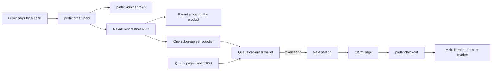

# pretix-nexa-vouchers

pretix plugin that, when a product is paid, creates pretix vouchers and matching **Nexa testnet** tokens, then lets a community queue hand those tokens on.

This is a clean-room implementation against pretix's public plugin API and Nexa's public token, Rostrum, and delegated-payment documentation. It is not the proprietary pretix "Voucher Sale" product, and it does not reuse that product's code.

Maintained by Nordic Crypto. Nexa is a separate network. This plugin does not operate Nexa and does not speak for the people who do.

License: [GNU AGPL-3.0 or later](LICENSE).

## What a paid product does

For each unit of a configured product, the plugin creates `voucher_count` pretix vouchers and one Nexa token per voucher.

| Setting on the product | Effect |
| --- | --- |
| Count | How many vouchers (and tokens) one sold unit creates. Cap: 1000. |
| Tag | Copied onto every pretix voucher. |
| Validity | A number of days after issue, a fixed end, or the earlier of the two. |
| Target products / quotas | Who may redeem the voucher. |
| Price effect and value | The same modes pretix vouchers already have (`none`, `set`, `subtract`, `percent`). |
| Reserve quota / bypass quota | Passed through when pretix can express them. |
| First holder | The event's issuer address, or a Nexa address taken from an order question. |

Vouchers are created when the order is **paid**, not when it is merely placed. A free order that pretix marks paid follows the same path.

## Token design

**One parent group per product, one subgroup NFT (quantity 1) per voucher.**

The parent group is the series ("this product's vouchers"). Each voucher is a distinct subgroup. The subgroup commitment is the SHA-256 of the plugin row's public id. The pretix voucher code is not written on chain.

A single fungible pile for a whole order would not tell pretix which voucher moved when someone sent a quantity of 1. A subgroup does: transferring that output transfers that voucher. When the plugin sees the token at a new address (queue confirm, or a signed claim), it rotates the pretix code. The previous code stops matching.

The parent group is created with nexad's `token new`. Each voucher then uses `token subgroup` and `token mint` of quantity 1 to the holder address. The group id and the hashed token-description document are stored on the series row. The document itself is served by the plugin at `…/nexa/token/<series-id>.json`.

## Redemption

Using the voucher in pretix is what spends it.

1. `validate_order` rejects the voucher if the token is already marked, still waiting to be issued, or not allowed for the product in the cart. pretix itself only stores one product **or** one quota on a voucher. If you select several, the native voucher is left open and this plugin enforces the set.
2. When the order that redeemed the voucher is paid, the plugin marks the token:
   - **burn address** holds the subgroup: record that output (`burn-address`). No second transaction.
   - **issuer wallet** still holds it: `token melt` of quantity 1.
   - **otherwise**: the issuer wallet broadcasts an OP_RETURN marker `NXVC:<public id>:<subgroup>`. Nexa cannot melt a coin the issuer no longer holds. The marker is the on-chain record; pretix will not accept the voucher again.

A failed marker is retried by pretix's periodic task. The pretix voucher stays unusable for a second order in the meantime (`redeem_pending`).

## Queue

A voucher list is a named queue (a hackerspace, a habitat, and so on). People join with a display name and a testnet address. The organiser, who holds the tokens in [Wally](https://gitlab.com/wallywallet/android), assigns the next issued token and gets a TDPP-style link for the send. After the token shows up at the recipient address, confirm the transfer. The recipient claims by signing a short message; pretix checks `verifymessage` and that the address holds the token, then shows the current voucher code and a shop link.

The organiser calls are authorised with a bearer token generated in the event settings. It is a shared secret stored in pretix's settings, not a blockchain key. Rotate it there if it leaks.

Wallet behaviour that Wally does not have yet is specified in [docs/wally-integration.md](docs/wally-integration.md). This repository does not change Wally.

## Architecture



Issuance and redemption run in `transaction.on_commit`, so a node error does not roll back the pretix payment. Rows that still need a mint or a marker are picked up by `periodic_task`.

## Install into pretix

The plugin registers the `pretix.plugin` entry point. pretix 2025.7 or newer discovers it after a normal pip install. No fork of pretix is required.

```bash
# inside the pretix virtualenv
pip install pretix-nexa-vouchers
python -m pretix migrate
python -m pretix rebuild
```

From a git checkout:

```bash
pip install -e /path/to/pretix-nexa-vouchers
python -m pretix migrate
python -m pretix rebuild
```

Restart pretix, open the event, and enable **Nexa vouchers**. Set the issuer address under Nexa voucher settings, then edit the pack product and turn issuance on.

Put the public source URL in those settings. Shop pages show it so visitors can get the corresponding source (AGPL-3.0, section 13).

## Configuration

Node credentials stay in the environment. Do not commit them, and do not put a password in the URL.

| Variable | Default | Meaning |
| --- | --- | --- |
| `NEXA_VOUCHERS_RPC_URL` | empty | nexad JSON-RPC URL, for example `http://127.0.0.1:7232/`. |
| `NEXA_VOUCHERS_RPC_USER` | empty | RPC user. |
| `NEXA_VOUCHERS_RPC_PASSWORD` | empty | RPC password. |
| `NEXA_VOUCHERS_ROSTRUM_URL` | empty | Rostrum JSON-RPC URL used for `token.address.listunspent`. |
| `NEXA_VOUCHERS_ALLOW_MAINNET` | off | Must be `1`, `true`, `yes`, or `on` before any mainnet call is attempted. |

**Mainnet is not cleared.** The flag defaults off. With the flag off, an event cannot select mainnet, and a stored `nexa` network blocks issuance instead of creating spendable vouchers. Turning the flag on is not a statement that mainnet is safe to use. Leave it off.

Event settings (control panel, not the environment):

- Issuer address, `nexatest:…`, controlled by the node wallet that mints and melts.
- Burn address, optional. A token sent here counts as redeemed.
- Source URL for the AGPL offer.
- Queue organiser token. Copy it into Wally out of band.

## Testnet setup

1. Run `nexad` for testnet (`nexatest`), not mainnet. The issuer wallet needs enough testnet NEX to pay for genesis, mints, melts, and marker transactions.
2. Run Rostrum against that node and set `NEXA_VOUCHERS_ROSTRUM_URL`.
3. Fund the wallet from a public testnet faucet, for example <https://testnet-faucet.nexa.org/>. Use Wally or the node wallet. Do not paste a seed or WIF into this repository or into pretix settings.
4. Export the RPC URL, user, and password into the pretix process environment.
5. In the event, set the issuer address to a `nexatest:` address that wallet controls. Leave the network on testnet.
6. Create the admission product the voucher should buy, then the pack product. On the pack, enable Nexa vouchers, set the count, the tag, the validity, and the target product or quota.
7. Pay a test-mode order. The Nexa vouchers page lists one subgroup per voucher. The buyer's order page shows the pretix code while the token is still at the issuer address. After the token moves, that page hides the code.

Rostrum only indexes a confirmed genesis. A mint that races an unconfirmed parent can sit in `chain_pending` until the periodic task retries it.

## Development

```bash
pip install -e ".[dev]"
ruff check .
pytest
```

Tests use pretix's pytest settings and a fake node (`tests/fake_nexa.py`). They do not contact Nexa. GitHub Actions runs ruff and pytest on Python 3.12.

## Limits

- Testnet is the supported network. Mainnet is behind `NEXA_VOUCHERS_ALLOW_MAINNET` and is not cleared.
- The issuer wallet must hold the parent-group authority. This plugin does not create or store keys.
- Melt only works while the issuer wallet still has the NFT. After a transfer, redemption is a marker transaction or a send to the burn address, not a remote melt.
- Until a transfer is confirmed or the new holder claims, the original pretix code still works. Confirming the send rotates it.
- pretix can attach a voucher to one product or one quota. Several targets are enforced only in this plugin's `validate_order` check.
- Reserving quota requires exactly one of those native targets.
- Issuance talks to the node after the payment commits. A dead node leaves `chain_pending` rows and vouchers that cannot be redeemed until a retry succeeds.
- If the node accepts `token new` and the response is lost, a later retry can create a second parent group. The first group is then unused.
- `createrawtransaction` / `signrawtransaction` / `sendrawtransaction` is the marker path. A Nexa build that only signs through `signrawtransactionwithwallet` will need that method added in `NexaClient.announce_marker`.
- Message proofs are `verifymessage` on the node, not an in-process Schnorr check.
- The queue organiser token is a shared secret. Joining a list is unauthenticated, so a public list can be spammed.
- Cancelling or refunding an order does not un-melt a token and does not restore a rotated code.
- At most 1000 vouchers are issued per order position.

## Layout

| Path | Role |
| --- | --- |
| `pretix_nexa_vouchers/` | Django app, models, signals, views |
| `pretix_nexa_vouchers/nexa.py` | Network guard and JSON-RPC client |
| `pretix_nexa_vouchers/services.py` | Issue, redeem, queue |
| `docs/wally-integration.md` | What Wally needs to add |
| `tests/` | pytest, with pretix's test settings and a mocked node |
